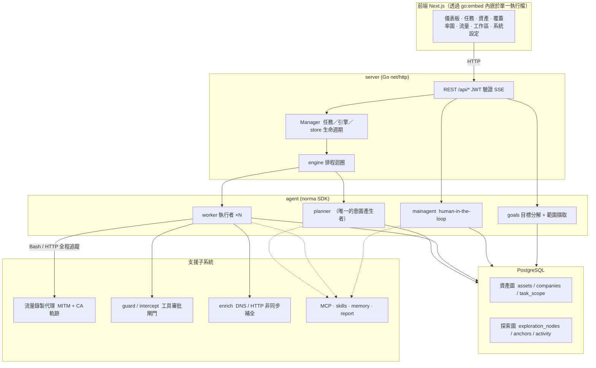
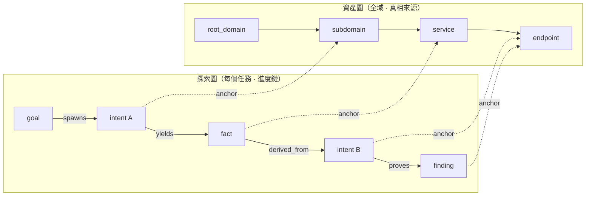
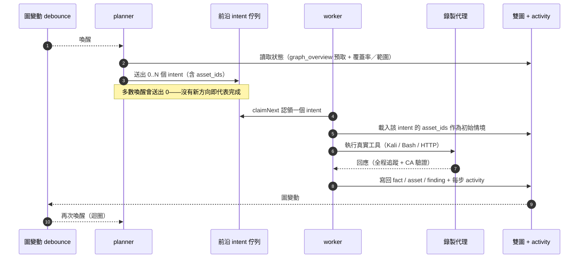
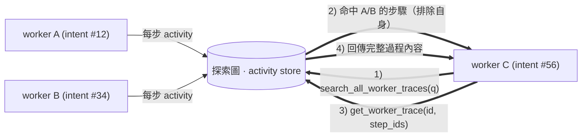
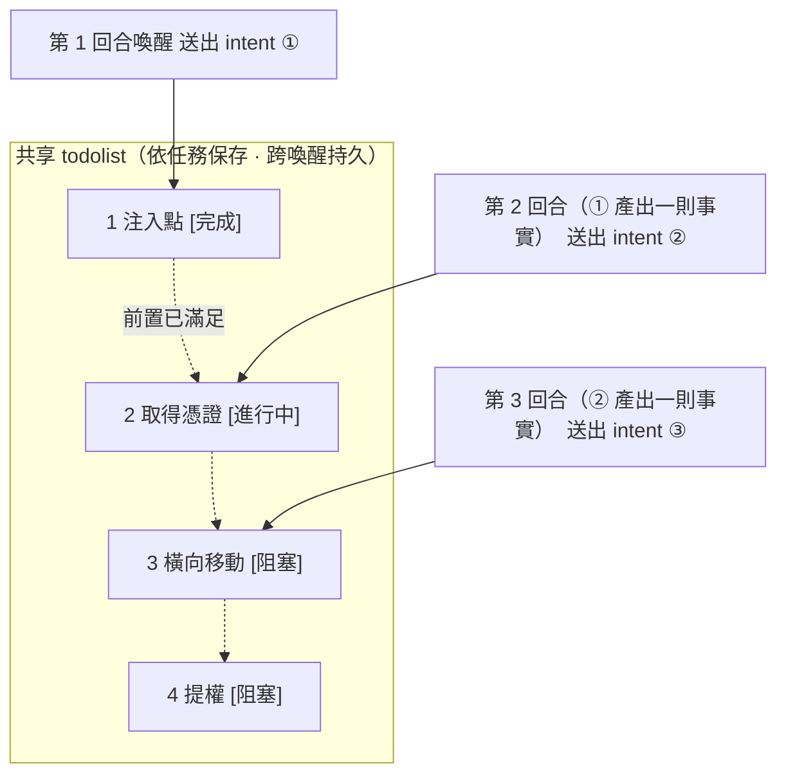

<div align="center">

# ScopeWeaver

以 LLM 多代理（multi-agent）打造的自主滲透測試系統（Go 後端 + Next.js 前端）

[English](README.md) · [한국어](README.ko.md) · 繁體中文

</div>

---

> **關於本專案。** ScopeWeaver 是 [Autumn-27/ARTEX](https://github.com/Autumn-27/ARTEX) 的衍生專案，
> 重新命名並翻譯為英文與韓文，以上游 commit `160fe13` 為基礎建置。

修改日期：**2026-10-02**。請見[來源與變更](docs/zh-TW/PROVENANCE.md)；這並不是發行版本標籤。

[驗證狀態與已知限制](docs/zh-TW/VERIFICATION.md)。

> 程式碼與架構皆源自 ARTEX。這個獨立的衍生專案變更了產品名稱、英文／韓文介面與訊息、文件，以及
> 發佈目標。完整的與上游差異清單請見[來源與變更](#來源與變更)，條款（維持不變，AGPL-3.0）請見
> [授權與免責聲明](#授權與免責聲明)。
>
> **使用授權。** 這是一套資安測試工具。只能用於你自己擁有、或已取得明確測試授權的系統。上游的使用
> 限制依然適用——請見下方說明。

---

## 語言

預設語言為英文。可在介面中選擇英文或韓文。伺服器端的持久預設值是系統設定中的 `language`；環境變數
備援值由 `SCOPEWEAVER_LANGUAGE`（或 `ARTEX_LANGUAGE`）提供。作業系統的 `LANG` 不會用來選擇應用程式
語言。

請求的語言選擇順序為：`lang`、支援的 `Accept-Language` 偏好、`scopeweaver_locale` cookie，最後才是
伺服器預設值。透過 HTTP 建立的新任務會在佇列與重啟後保留其語言；較舊、未儲存語言的任務則使用伺服器
預設值。內建的代理指引與輸出指示會採用執行時的語言；使用者編輯過的範本與已儲存的證據則維持原狀。
報告／CSV／ZIP 的標籤會採用匯出請求當下的語言。[完整文件](docs/README.md)與[韓文參考文件](docs/ko/README.md)
均含內建技能（skill）指引。

## 畫面截圖

下列截圖呈現的是搭配內附虛構示範資料的 ScopeWeaver 英文介面，並非對真實目標的掃描結果。另可參考
[韓文截圖](README.ko.md#스크린샷)與[行動版畫面](screenshots/en/mobile.png)。

| 儀表板 | 任務 |
| :---: | :---: |
|  |  |
| 發現 | 設定 |
|  |  |

原始的中文截圖仍保留在[截圖目錄](screenshots)中，出處為
[上游 ARTEX](https://github.com/Autumn-27/ARTEX/tree/160fe13c243be361eeac5408c40a96e824fa842c/screenshots)。

---

## 審批紀錄

全域的「審批紀錄」檢視、任務內的「攔截審批」面板，以及對話中顯示的審批卡片，都可以展開以顯示完整
細節。其呈現方式沿用
[AegisHook 的審批細節元件](https://github.com/RuoJi6/AegisHook/blob/main/web/src/components/CallDetail.vue)，
重用上游的元件與主題。

## 資產同步（ScopeSentry）

你可以直接從 [ScopeSentry](https://github.com/Autumn-27/ScopeSentry) 同步資產資料，省去重複蒐集同一份
資料的工夫：

- 在**資產同步**頁面輸入你的 ScopeSentry 位址與 API 金鑰，以連接資料來源。
- 選擇依**專案**或依**任務**來同步，並挑選資產類型（網域／子網域／IP／連接埠／站台／端點……）。
- 一鍵匯入。資產會合併進公司資產範圍，並直接進入資產圖供代理探索。

---

## 安裝

### GLM 與其他模型供應商

**LLM → 新增**表單內含 Z.ai General API 的 GLM-5.3 設定範本，以及另外標示的 Coding Plan 參考設定。
請填入你自己的 API 金鑰；選取範本並不會儲存、啟用或連線任何供應商。Coding Plan 的使用僅限官方支援的
工具，而 ScopeWeaver 並不在清單中。請見[供應商設定與支援限制](docs/zh-TW/llm-providers.md)。

> 需要一個 **PostgreSQL** 資料庫。進行探索需要設定好 **LLM**
> （`ANTHROPIC_API_KEY` 或 `OPENAI_API_KEY`，或在 UI 中設定）。

### 選項 1：一鍵安裝腳本（建議）

```bash
git clone https://github.com/cskwork/scopeweaver.git
cd scopeweaver
./install.sh
```

腳本會偵測（並視需要安裝）Docker，接著讓你選擇 **① 全部跑在 Docker 裡**或 **② 在本機建置並執行**：

- **① 全部 Docker**：輸入一組 Postgres 密碼（按 Enter 則隨機產生）→ 寫入 `.env` →
  `docker compose up -d`。
- **② 本機**：挑選資料庫（連到既有的，或用 Docker 起一個）→ 產生 `config.json` → `go` 會編譯出一個
  內嵌前端的單一執行檔 → 啟動。

啟動後，開啟 **http://localhost:8787**（首次造訪會導向 `/setup` 設定管理員密碼）。

> 這些腳本預設使用英文。若要韓文提示，執行前設定 `SCOPEWEAVER_LANGUAGE=ko`（或 `ARTEX_LANGUAGE=ko`），
> 例如 `SCOPEWEAVER_LANGUAGE=ko ./install.sh`。

### 選項 2：Docker Compose（手動）

```bash
git clone https://github.com/cskwork/scopeweaver.git
cd scopeweaver
cp .env.example .env          # 設定 POSTGRES_PASSWORD，必要時設 ANTHROPIC_API_KEY
docker compose up -d --build  # 在本機建置 scopeweaver 映像檔 + postgres
# → http://localhost:8787
```

> 預設的 compose 檔會**從本機原始碼建置映像檔**。若要改用 `ghcr.io/cskwork/scopeweaver` 的已發佈
> 發行映像檔，請在 compose 中明確指定其版本。

映像檔內含常用工具（ripgrep/curl/vim/npm/nmap……）；`./skills` 與 `./data` 以 bind mount 掛入，因此
會持久保留。

遠端 MCP 可在系統設定中使用 `http`（Streamable HTTP）或 `sse`（舊版 SSE）。舊版 SSE 伺服器通常以
`GET /sse` 開啟事件串流，接著在伺服器回傳的 `/message?sessionId=...` 上接收 JSON-RPC 請求；請將 URL
設為 `/sse`，標頭設為 `Authorization=Bearer <token>`。

### 選項 3：下載預先建置好的執行檔（Releases）

> 從 [Releases](https://github.com/cskwork/scopeweaver/releases) 下載對應平台的壓縮檔。各平台的壓縮檔
> 名稱為 `scopeweaver-<version>-<os>-<arch>.zip`，解壓後含 `scopeweaver` + `start.sh`
> （Windows 為 `start.bat`）+ `skills/` + `config.example.json`：

壓縮檔也包含 `adapters/agent/`；請見[代理設定說明](adapters/agent/README.md)。

```bash
cp config.example.json config.json   # 填入資料庫連線資訊
./start.sh                            # → http://localhost:8787
```

> 請用 `start.sh` / `start.bat` 啟動，而不要直接執行 `./scopeweaver`。它是一個監管程序（supervisor）：
> 程式結束後，它會依結束碼判斷是否重新啟動，而[應用程式內的一鍵更新](#選項-1應用程式內一鍵更新建議)
> 也仰賴它來換入新版建置。直接執行 `./scopeweaver` 會導致更新後無法重新啟動。
> 若要在背景執行：`nohup ./start.sh >scopeweaver.log 2>&1 &`。

### 選項 4：從原始碼建置單一執行檔

```bash
# 1) 將前端匯出為靜態檔案
cd web && npm ci && npm run build:static && cd ..
# 2) 複製到內嵌目錄
mkdir -p server/webui/dist
cp -R web/out/. server/webui/dist/
# 3) 建置（embedui tag 會把前端內嵌進去）
CGO_ENABLED=0 go build -tags embedui -o scopeweaver ./cmd/artex
./start.sh
```

> 為了與上游相容，建置來源路徑維持 `./cmd/artex`，Go module 也維持
> `github.com/Autumn-27/artex`。只有輸出的執行檔命名為 `scopeweaver`。

### 選項 5：建置跨平台發行壓縮檔

`build.sh` 會建置並內嵌前端、以 Go linker 去除除錯資訊，並將每個發行版打包成 zip。release 模式預設會
建置 Linux amd64/arm64、macOS amd64/arm64，以及 Windows amd64：

壓縮檔內含 `THIRD_PARTY_NOTICES.txt`；容器映像檔也會在 `/app/THIRD_PARTY_NOTICES.txt` 保留同一份聲明，
用於內附的 shadcn 樣式表。

```bash
./build.sh --release
# 輸出：dist/scopeweaver-0.3.3-*.zip
```

以 UPX 打包的自解壓執行檔，在某些 Linux 核心、虛擬化環境或安全性政策下可能發生衝突，因此 UPX 預設關閉。
可用 `ARTEX_TARGETS` 設定自訂目標，並在確認目標相容後明確加上 `--upx`：

```bash
ARTEX_TARGETS=linux/amd64,windows/amd64 ./build.sh --release
./build.sh --target linux/amd64 --upx
```

### 反向代理部署

正式環境建置會從同一來源（same origin）提供 UI、API 與即時 SSE 串流。你可以在 443 埠對外提供 HTTPS，
同時讓後端連接埠保持私有。請關閉代理緩衝並允許長連線，讓即時事件能送達瀏覽器：

```nginx
location / {
    proxy_pass http://127.0.0.1:8787;
    proxy_set_header Host $host;
    proxy_set_header X-Forwarded-Proto $scheme;
    proxy_http_version 1.1;
    proxy_set_header Connection "";
    proxy_buffering off;
    proxy_cache off;
    proxy_read_timeout 3600s;
}
```

只有當 SSE 使用不同來源時，才需要在建置時設定 `NEXT_PUBLIC_SSE_BASE`。在容器執行階段更改它並不會改變
已匯出的前端。在 `next dev` 期間，SSE 仍會直接連到 8787 埠以繞過 Next.js 的緩衝；明確給一個空的
`NEXT_PUBLIC_SSE_BASE` 則代表選擇同一來源。

---

## 更新

> 更新只會換掉程式本身，你的資料原封不動。Postgres volume `pgdata`、`./data`
> （jwt.key／SQLite／……）與 `./skills` 都會保留。**資料庫遷移會自行處理**——`scopeweaver` 每次啟動都會
> 冪等地重跑 `schema.sql`（包含 `ADD COLUMN` / `CREATE INDEX IF NOT EXISTS`），所以「重啟即遷移」。
> 儘管如此，升級前仍請備份 `./data` 與資料庫。

### 選項 1：應用程式內一鍵更新（建議）

在**系統設定**頁（側邊欄「系統設定」→ `/system/settings`）的**版本與更新**卡片，可以在不登入伺服器的
情況下檢查並安裝新版本。

按下「更新」後：它會下載你平台對應的發行版 → 以發行版的 `SHA256SUMS` 核對 → 用 `-h` 對新執行檔做煙霧
測試 → 暫存為 `scopeweaver.new` → 程式結束，由 `start.sh` / `start.bat` 重新啟動以完成替換。頁面會等待
新版本起來後重新整理。

- **更新失敗不會留下壞掉的程式**：若驗證或煙霧測試失敗，暫存檔會被丟棄，當前版本繼續執行。若換入的版本
  連續三次無法啟動，會自動回滾到 `scopeweaver.old`（失敗的版本會保留為 `scopeweaver.failed` 以便檢視）。
- **隨時可回滾**：前一版會保留為 `scopeweaver.old`，卡片上也有「回滾到前一版」按鈕。請注意，資料庫
  schema 不會一併回滾。
- **更新會中斷執行中的任務**——更新等同於重啟，因此請在閒置時進行。
- **開發版建置不會更新**：當版本為 `dev` 或帶後綴的 `git describe` 字串時，此功能會停用，以免發行版覆蓋
  你在本機建置的除錯執行檔。
- **在 Docker 下，只更新程式、不更新映像檔**：映像檔中的 playwright／nmap 工具鏈不會隨之升級，而以
  `docker compose up -d` 重建容器則會退回映像檔中內建的版本。若要連映像檔一起升級，請用
  `docker compose pull scopeweaver && docker compose up -d scopeweaver`（需已有已發佈的映像檔；否則用
  `docker compose up -d --build scopeweaver`）。
- 若連線 GitHub 需要代理，請在同一頁設定**全域代理**，更新流程便會使用它。更新只會從 GitHub 網域下載，
  並強制使用 HTTPS。

### 選項 2：一鍵更新腳本

```bash
cd scopeweaver
./update.sh
```

腳本可選擇先執行 `git pull`，接著讓你選擇 **① Docker 更新**或 **② 本機建置更新**（與 `install.sh` 對應）：

- **① Docker**：以 `docker compose build scopeweaver` 重建當前 checkout，再用
  `docker compose up -d scopeweaver` 重新建立服務。
- **② 本機**：重建前端靜態輸出 → 重新編譯 `./scopeweaver`（重啟程序以套用）。

### 選項 3：Docker Compose（手動）

```bash
cd scopeweaver
git pull                       # 更新 compose／腳本（選用）
# 若要釘選某個原始碼版本，建置前請先 checkout 一個已審閱的 tag 或 commit。
docker compose up -d --build scopeweaver   # 從原始碼重建並重啟 → 自動遷移 schema
docker image prune -f          # 清理舊映像檔（選用）
```

> 一旦有已發佈的映像檔，且 compose 明確指定它，就可將建置步驟換成
> `docker compose pull scopeweaver && docker compose up -d scopeweaver`。

### 選項 4：預先建置的執行檔（Releases）

下載新的 `scopeweaver-<version>-<os>-<arch>.zip`，停掉舊程序，覆蓋 `scopeweaver` 與 `skills/`
（保留你的 `config.json` 與 `data/`），然後重啟：

```bash
cp -r <unpacked>/skills ./ && cp <unpacked>/scopeweaver ./
./start.sh
```

### 選項 5：從原始碼建置

```bash
git pull
cd web && npm ci && npm run build:static && cd ..
cp -r web/out server/webui/dist
CGO_ENABLED=0 go build -tags embedui -o scopeweaver ./cmd/artex
# 重啟 ./start.sh
```

---

## 設定

### 編碼代理（coding-agent）整合

Claude Code、Codex 與 Pi 可以透過[代理轉接器](adapters/agent/README.md)建立任務，並讀取進度、覆蓋率與
發現。Claude Code／Codex 使用本機 stdio MCP；Pi 使用原生擴充。讀取預設啟用，而建立任務與暫停／繼續則需
透過設定明確啟用。轉接器使用既有的已驗證 API，並維持 ScopeWeaver 內部代理與模型設定不變。

**資料庫**（`config.json`，或以環境變數 `ARTEX_PG_DSN` 覆蓋）：

```json
{
  "database": {
    "host": "127.0.0.1", "port": 5432,
    "user": "artex", "password": "yourpass",
    "dbname": "artex", "sslmode": "disable"
  }
}
```

> 為了與上游相容，設定與環境變數的鍵名維持 `ARTEX_*` 前綴，資料庫預設值也維持 `artex`。在有註記之處，
> 腳本也接受 `SCOPEWEAVER_*` 別名。

**LLM**：`export ANTHROPIC_API_KEY=sk-...`（或 `OPENAI_API_KEY`），或在 UI 的「LLM 設定」頁設定。
選用：`ARTEX_LLM_PROVIDER` / `ARTEX_LLM_MODEL` / `ARTEX_LLM_BASE_URL` / `ARTEX_LLM_PROXY`。

**並行數**：每個任務的工作代理數量，在「系統設定」中設定（預設 3）。

**常用旗標**：`./start.sh -addr :8787 -proxy :8788`（`-addr` 是前端 + API，`-proxy` 是流量擷取代理）。
啟動腳本會把旗標直接傳給 `scopeweaver`。

---

## 開發

歡迎貢獻。關於需求、檢查項目，以及 pull request 如何審閱與合併，請見 [CONTRIBUTING.md](CONTRIBUTING.md)。

### 手動漏洞複測

任務細節的「複測」分頁會將任務的漏洞分頁顯示，列出每個漏洞過往的結論與證據，並讓你手動發起複測。發起
後會停留在當前分頁，顯示轉圈圖示與「複測中」；當確認修復後，會更新漏洞狀態。

在漏洞清單某一列點「複測」，或在漏洞細節的「複測」區塊點「開始複測」，並填入選用的修復版本、測試條件或
限制。系統會建立一個獨立的複測代理工作階段，並停留在當前頁面。扁平檢視、依任務分組檢視與資產檢視都提供
此入口；執行中的複測會顯示轉圈圖示與「複測中」，點進去即可檢視該工作階段。結束後會回到「複測」。複測
不會重啟原本的掃描任務。結論分為「仍可重現」、「已修復」或「無法確認」，而每個結論、其證據與工作階段
連結都會存進漏洞細節。

較新的後端會在首次啟動時，預先建立一個可編輯的「漏洞複測」（`retester`）代理；你可以在代理管理中設定其
提示詞、LLM、執行預算與工具。它預設使用其綁定的 LLM，若未綁定則使用全域啟用中的設定。當複測工作階段
成功結束並得到「已修復」結論時，系統會自動將漏洞處置設為「已修復」；執行中、失敗、停止或其他結論則維持
原狀態。原始的證據與報告一律保留。你也可以從狀態下拉選單手動設為「已修復」。

此版本的歷史是透過漏洞細節與工作階段檢視；它尚未進入漏洞報告匯出或任務封存，也尚未自動連結到流量擷取。
示範模式只會產生明確標示的模擬紀錄，不會觸及真實目標。

### 本機執行與測試

```bash
./dev.sh    # 後端(:8787) + 流量代理(:8788) + 前端 next dev(:5173) → http://localhost:5173
```

- 後端：`go run ./cmd/artex`（不加 `-tags embedui` 時不會內嵌前端）
- 前端：`cd web && npm run dev`（`/api` 會反向代理到後端，並支援熱重載）
- 測試：`go test ./...`
- Mock 預覽（免後端）：`cd web && NEXT_PUBLIC_MOCK=1 npm run dev`

---

## 架構

ScopeWeaver（底層為 ARTEX）是一套 **LLM 多代理自主滲透系統**：由單一 Go 後端（內嵌 Next.js 前端）加上
PostgreSQL 組成。代理能力來自 [`norma`](https://github.com/Autumn-27/norma) SDK
（`agentcore` / `tool` / `permission` / `harness` / `memory` / `transcript`）。核心是一套**雙圖架構**，
並圍繞它建立兩種自主機制：**worker 之間的行程級資訊交換**，以及**planner 跨回合共享的 todolist，用以
維持攻擊鏈穩定**。

### 分層



| 分層 | 職責 |
| --- | --- |
| **前端** | Next.js 靜態匯出，以 `go:embed` 內嵌於單一執行檔；視覺化任務／資產／探索／覆蓋率與 human-in-the-loop 對話 |
| **server** | `net/http` 路由 + JWT 驗證 + SSE；`Manager` 掌管任務、引擎與 DB store 的生命週期 |
| **engine** | 每個任務一個 `plannerLoop` + N 個 worker goroutine；意圖認領、逾時／暫停／drain |
| **agent** | goals / planner / worker / mainagent；`ToolSet` 把雙圖以 LLM 工具形式對外曝露 |
| **db** | 兩張圖的 Postgres 後端（pgx）；schema 以 `go:embed` 內嵌，每次啟動冪等建立 |
| **支援** | 錄製型 MITM 代理、審批閘門、非同步補全、MCP/skills/memory/report |

### 雙圖架構：探索圖 + 資產圖

系統把「**目標是什麼**」與「**已經測到哪裡**」拆成兩張透過 anchor 相連的獨立圖：

- **資產圖（全域、共享）**：跨任務的資產唯一真相來源。節點為
  `root_domain / subdomain / ip / service / app / endpoint`，各自歸屬於一間公司。
  網域→子網域→服務→端點的父子關係與去重鍵，全都由程式計算；代理只負責提交原始觀測結果。
- **探索圖（每個任務一張）**：一個任務的「思考與進度」。節點為
  `goal / intent / fact / finding / hint`，以 `spawns / derived_from / yields / proves` 邊連成一條
  **譜系鏈（lineage chain）**，可回答「哪個方向由哪些事實衍生而來、又產出了什麼」。
- **兩張圖透過 anchor 相連**：`exploration_anchors(node_id, asset_id)` 會把某個 intent／fact／finding
  錨定到特定資產——因此你能看出某個方向正在探測哪些資產，也能從任一資產回頭看本任務中有哪些 intent
  測過它、產出了哪些事實。這同時也驅動**資產測試覆蓋率**與**資產覆蓋率圖**（範圍內資產 + 已測高亮）。



> 分工：**planner** 讀取探索圖的狀態、判斷目標，只有在有尚未涵蓋的新方向時，才把一個 **intent** 送進
> 前沿（frontier）；**worker** 認領**一個 intent**、執行真實工具、把新的資產／事實／發現寫回兩張圖，
> 然後停止。資產圖是共享事實；探索圖是每個任務的進度鏈。

### 引擎與意圖生命週期（一次探索迴圈）

引擎是一個**事件驅動**的迴圈：圖的變動會喚醒 planner，planner 送出 intent，worker 認領一個 intent、
執行後寫回，而寫回又觸發下一回合——直到目標被證明（`prove_goal`）。



### worker 之間的行程級資訊交換

在深度探索中，許多有價值的觀測（一則錯誤、一段回應、一個隱藏參數）只出現在某個 worker 的**執行過程**裡，
卻沒有被寫成正式的事實。為了避免重複工作，也讓同一條鏈上的 worker 能站在彼此的肩膀上，worker 可以
**跨其他 worker 的執行過程搜尋**：

- `search_all_worker_traces(q)`：對**本任務中其他工作的執行過程**做關鍵字搜尋（會自動排除此 intent 自己
  的步驟）；命中結果會帶有 `intent_id`。
- `list_worker_traces` / `get_worker_trace(intent_id, step_ids=[…])`：先看有哪些工作跑過，再把某個工作
  特定步驟的完整內容拉出來做細部交流。

因此即使探索圖中還沒有對應的事實，後續的 worker 也能重用他人過程中的觀測——**資訊以「執行過程」的
粒度在 worker 之間流動**，同時邊界依然成立（每個 worker 仍然只做它認領的那一個 intent）。



### planner 跨回合共享的 todolist → 穩定的攻擊鏈

真實的攻擊鏈往往是**帶有相依關係的多步驟序列**（找到注入點 → 取得憑證 → 橫向移動 → 提權）。把這整串
一次全部平行送出只會造成混亂。因此 planner 會持有一份**依任務保存、並跨喚醒共享的規劃 todolist**：

- planner 是事件驅動的——圖的變動會喚醒它，但**每次喚醒都是全新的工作階段**；共享的 todolist 讓它能
  **把一條序列式的利用鏈記錄一次**，再依相依關係**跨回合逐步送出 intent**，而不是在單一回合就把整條鏈
  一次攤開。
- 每一回合只為「前置條件已完成、且所依賴的事實已存在」的下一步送出 intent，並隨之更新清單（把事實已
  滿足的步驟標記為完成）。



如此一來，在「事件驅動 + 無狀態工作階段」的設定下，攻擊鏈依然能**穩定推進、不重複、不錯序**——這正是
系統能自行走完多步驟利用鏈的關鍵。

---

## 來源與變更

ScopeWeaver 衍生自 [Autumn-27/ARTEX](https://github.com/Autumn-27/ARTEX)，以上游 commit `160fe13` 為
基礎。本獨立衍生專案的變更：

- **產品名稱**：在使用者可見的文件、腳本與發佈中，將「ARTEX」→「ScopeWeaver」。為了與上游相容，Go
  module（`github.com/Autumn-27/artex`）、建置來源路徑（`./cmd/artex`）、`ARTEX_*` 設定／環境鍵，以及
  `artex` 資料庫預設值都**維持不變**。
- **文件語言**：預設為英文；韓文翻譯位於 [README.ko.md](README.ko.md) 與 [docs/ko](docs/ko/README.md)
  之下。
- **腳本語言**：setup／build／start／update／reset-password 的提示預設為英文，可透過
  `SCOPEWEAVER_LANGUAGE=ko`（`ARTEX_LANGUAGE=ko` 亦可）選用韓文。不使用任何網路翻譯。
- **發佈**：輸出執行檔為 `scopeweaver`，發行壓縮檔為 `scopeweaver-<version>-<os>-<arch>.zip`，儲存庫為
  `https://github.com/cskwork/scopeweaver`，容器映像檔以本儲存庫的 GHCR 為目標。不使用上游的 Docker Hub
  映像檔（`autumn27/artex`）。
- **ScopeWeaver 發行歷史**：獨立發行版從 `v0.1.0` 起算，發行說明位於
  [log/](log/changelog-v0.1.0.md) 之下。版本標籤會觸發各平台壓縮檔與容器建置。除非明確指定已發佈的
  映像檔，否則 Docker Compose 仍會在本機建置。

[CHANGELOG.md](CHANGELOG.md) 中的 changelog 翻譯，忠實描述的是**上游 ARTEX** 專案的歷史；並不會把那些
變更歸功於 ScopeWeaver。

### 截圖與在地化素材

在地化截圖位於 `screenshots/en/` 與 `screenshots/ko/`，呈現內附的示範資料在桌面與行動裝置上的樣貌。
`screenshots/` 中其他位置的原始 ARTEX 截圖維持不變，並標註出處為上游。

---

## 致謝

- **上游**：[Autumn-27/ARTEX](https://github.com/Autumn-27/ARTEX)——本衍生專案的來源。原始程式碼與架構
  歸功於其作者。
- **代理 SDK**：[`norma`](https://github.com/Autumn-27/norma)。
- **資產同步**：[ScopeSentry](https://github.com/Autumn-27/ScopeSentry)。
- **審批細節 UI**：[AegisHook](https://github.com/RuoJi6/AegisHook)。
- **參考**：[Cairn](https://github.com/oritera/Cairn)。
- **上游社群**：ARTEX 作者經營微信公眾號 **SecSentry**（`screenshots/wx.png` 是他們的 QR code，作為上游
  素材保留）。這是上游專案的管道，不是 ScopeWeaver 的管道。

---

## 授權與免責聲明

> 本節保留上游的授權，以及作者的使用限制與免責聲明，忠實譯自 ARTEX。條款維持不變。

### 開源授權

本專案以 **GNU Affero General Public License v3.0（AGPL-3.0）** 授權。完整條款見儲存庫根目錄的
[LICENSE](LICENSE) 檔。

這代表任何人都可以自由使用、修改與散布本專案，但**衍生作品也必須以 AGPL-3.0 開源**；特別是，**若你修改
本專案並透過網路（例如作為託管服務）提供給使用者，你也必須向那些使用者提供對應的完整原始碼。**

> ⚠️ **重要**：開源授權本身並不限制軟體可以如何被使用。下方的「使用限制」與「免責聲明」是額外的條件，
> 也是作者對使用者的嚴正聲明，請務必遵守。

**ARTEX 僅供個人學習、原始碼研究與本機技術驗證之用。不得用於對任何線上系統或網站發動真實測試。**

### 允許的使用

- 僅限於**閱讀、學習與研究本專案原始碼**，以及在**本機隔離環境**中驗證技術原理。
- 適用於個人學習、學術研究、程式碼審查等非攻擊性用途。

### 禁止事項

- **不得使用本工具掃描、探測、利用或攻擊任何網站、線上服務或連網系統**（無論你是否獲得授權，也無論該
  資產是否為你所有）。
- 不得將本工具用於任何真實滲透測試、紅藍對抗演練或正式環境。
- 不得將本工具用於非法入侵、資料竊取、勒索、阻斷服務，或任何破壞性或犯罪行為。
- 不得將本工具用於任何違反你所在國家或地區法律法規之事。

### 合規責任

使用者必須遵守其所在國家或地區所有關於網路安全、資料保護與電腦犯罪的法律法規（在中國大陸，包含但不限於
《網路安全法》、《資料安全法》、《個人資訊保護法》及相關司法解釋）。**因使用本工具而產生的一切法律責任
與後果，均由使用者自行承擔。**

### 免責聲明

本專案依「現狀」（AS IS）提供，不附任何明示或默示的擔保。對於因使用本工具而造成的任何直接或間接損失、
資料遺失、系統損害或法律爭議，無論使用是否得當，作者與貢獻者概不負責。**下載、安裝或使用本專案，即表示
你確認已閱讀、理解並同意上述所有條款。**
</content>
</invoke>
